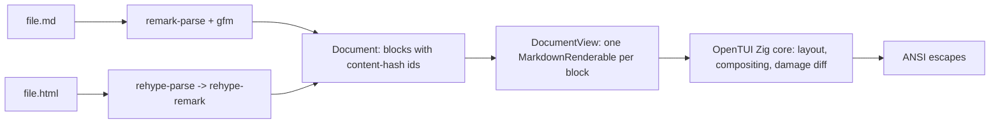
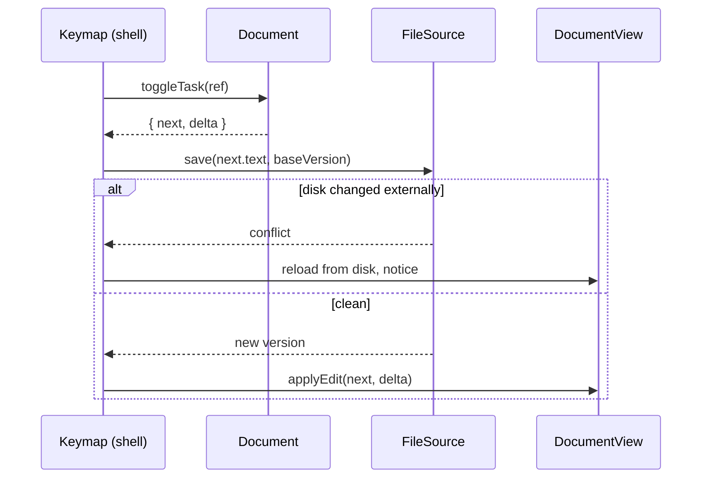

# sim architecture

A test document that doubles as the architecture breakdown. Open it with
`sim docs/architecture.md` and it exercises every renderer path: headings,
tables, task lists, code, mermaid, blockquotes, links, and inline styles.

## The pipeline

Every file becomes **mdast**, then blocks, then renderables. Formats differ
only at the adapter boundary; everything downstream is format-blind.



> Note: `@opentui/core` 0.4.3 renders mermaid fences as highlighted code;
> native mermaid renderables landed upstream after this release. When the pin
> moves, this diagram starts drawing itself. That is the test.

## Layers

| Layer | Directory | May import | Depth |
|---|---|---|---|
| Document | `src/document/` | unified only | deep: parse, block index, splice write-back |
| Source | `src/source/` | node:fs, node:crypto | deep: atomic saves, conflict refusal |
| View | `src/view/` | `@opentui/*` | deep: reconcile-by-id, theme |
| Shell | `src/shell/` | `@opentui/*` + above | thin: keymap, save flow |
| CLI | `src/cli.ts` | everything | thin: argv, TTY detect |

The import rule is the architecture: *renderer churn cannot reach the
document model*, and ~~whole-document regeneration~~ never happens: edits are
positional splices.

## The write-back invariant

The deepest contract in the codebase, defended by `test/document.test.ts`:

```ts
const doc = openDocument(text, markdownAdapter);
const { next } = doc.replaceBlock(block.id, block.markdown);
next.text === text; // byte-identical, always
```

1. Parse keeps source offsets on every top-level node
2. An edit splices `[start, end)` in the original string
3. The whole document re-parses (microseconds at file scale)
4. Content-hash ids keep unchanged blocks identical across the re-parse

### Try it here

These are live checkboxes. Select with `tab`, toggle with `x`, then run
`git diff docs/architecture.md`: the diff is exactly one 3-byte marker.

- [ ] toggle me
- [x] then check the diff
- [x] trailing whitespace on this line survives the round-trip   
- [x] nested items work too:
  - [x] like this one

## Edit flow



The *conflict* branch is why `sim` never clobbers a file another editor
touched: `save` compares content hashes before writing, and the temp+rename
write is atomic.

## What the renderer does with this file

- Headings 1-3: styled and concealed (no `#` visible)
- The table above: bordered GFM grid
- `inline code`, **bold**, *italic*, ~~strikethrough~~: concealed markers
- [Links render styled](https://git.harivan.sh/harivansh-afk/sim) with the URL underlined
- Code fences: tree-sitter highlighting (the `ts` block above)

---

Everything below `document/` is furniture. That is the design.
