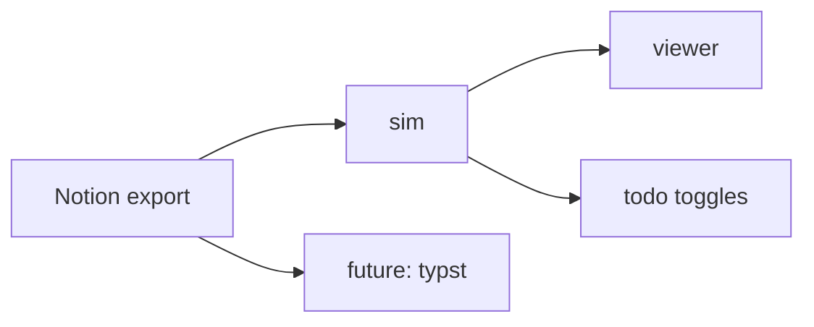
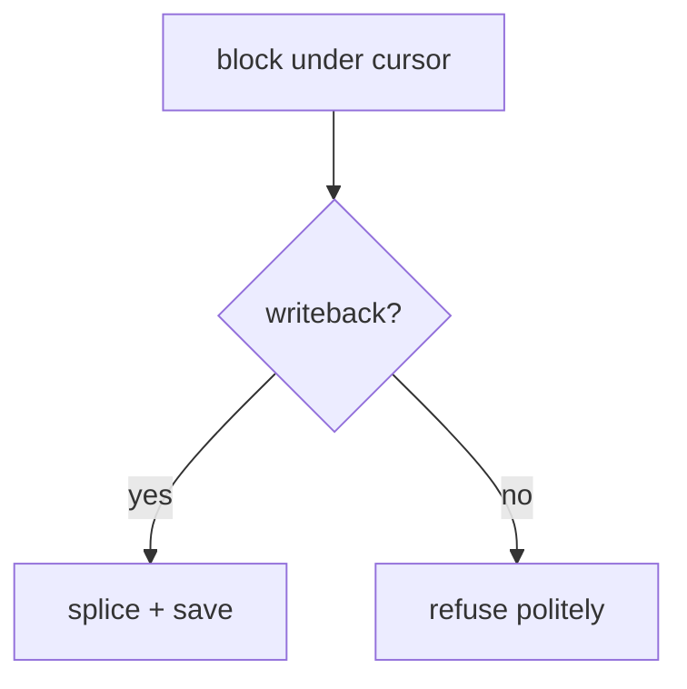
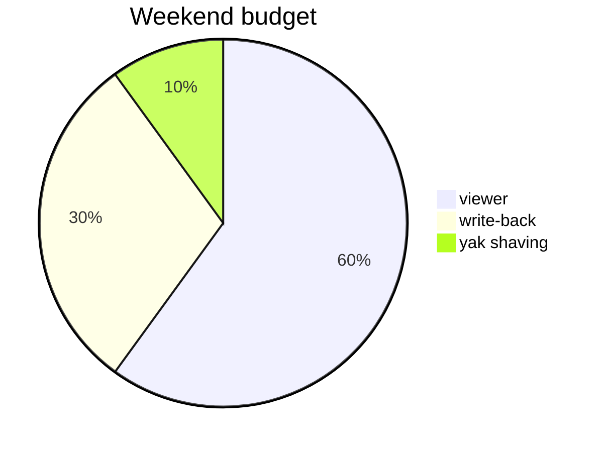

# Notion artifacts test

Every block type a Notion markdown export can produce, in one file. Open with
`sim docs/notion-artifacts.md`. Each section names the construct and what sim
does with it today. This file is the renderer's compatibility contract:
when behavior changes, this document is where it shows first.

---

## Inline styles

**bold**, *italic*, ***bold italic***, ~~strikethrough~~, `inline code`,
and a [link](https://git.harivan.sh/harivansh-afk/sim). Notion underline
exports as HTML: <u>underlined text</u> passes through as raw inline HTML
(rendered literally, not styled - known limit).

Inline equation: $E = mc^2$ renders as literal TeX. No math engine in alpha.

## Headings

### Heading 3

Notion only exports depths 1-3. Deeper ones exist in markdown anyway:

#### Heading 4 renders too

## To-do lists

- [ ] plain todo
- [x] completed todo
- [ ] todo with **bold** and `code` in the label
  - [ ] nested todo under a todo
- [ ] toggle any of these with tab + x; the file changes by exactly 3 bytes

## Toggle lists

Notion toggles export as plain bullets in markdown (details/summary only in
HTML exports):

- This was a toggle in Notion
  - Its hidden children become nested bullets
  - Nothing collapses in sim: everything is visible

<details>
<summary>An HTML-export toggle looks like this</summary>

Content inside a details block. Renders as raw HTML lines plus this
paragraph - visible, not collapsible.

</details>

## Callouts

Notion callouts export as blockquotes with an emoji prefix:

> 💡 This is a callout. sim renders it as a styled blockquote with the emoji
> intact. No special callout chrome in alpha.

> [!NOTE]
> GitHub-style admonitions render as plain blockquotes too. A normalize
> plugin can upgrade both later without touching the renderer.

## Quote

> The import rule is the architecture.

## Divider

Above this sentence: a horizontal rule from `---`.

---

## Table (Notion database export)

| Name | Status | Effort | Tags |
| --- | --- | --- | --- |
| mermaid flowcharts | done | 1 evening | view, registry |
| sequence diagrams | fallback | - | honest |
| math rendering | not planned | - | alpha limit |

## Numbered list

1. first
2. second
   1. nested numbered
   2. another
3. third

## Code block

```ts
// tree-sitter highlighted via the markdown renderable
export function contentHash(markdown: string): string {
  let hash = 0x811c9dc5;
  for (let i = 0; i < markdown.length; i++) {
    hash ^= markdown.charCodeAt(i);
    hash = Math.imul(hash, 0x01000193);
  }
  return (hash >>> 0).toString(36);
}
```

## Mermaid

Notion embeds mermaid as a code block; sim lays flowcharts out natively:





An unsupported type stays a highlighted code block:



## Block equation

$$
\int_a^b f(x)\,dx = F(b) - F(a)
$$

Renders as literal TeX text (same alpha limit as inline math).

## Image


Images render as their alt text and link; no inline graphics in alpha
(terminal image protocols are a future adapter concern).

## Emoji and unicode

Emoji pass through: 🚀 📝 ✅ - and CJK width matters: 日本語のテキスト.

---

Last block: everything above survived a byte-identical round-trip through
the block model to render this line.
